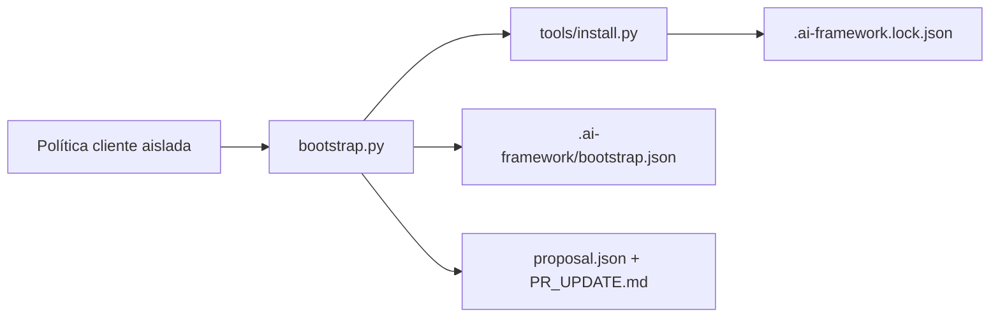

# M4 — Arquitectura de distribución corporativa

## Componentes

`bootstrap.py` valida versión y política, detecta adopción o actualización y
delega los artefactos administrados a `install.py`. El lock
`capability-lock/v1` sigue siendo la fuente de verdad de archivos, hashes,
commit, versión y capacidades.

## Actualización y conflictos

- La misma versión/capacidades es idempotente.
- Un lock diferente requiere la ruta de upgrade de `install.py`.
- Cambios locales a archivos administrados y destinos no administrados bloquean
  la actualización.
- La adopción inicial sin lock bloquea archivos ya presentes salvo
  `--replace-framework-artifacts`.
- El bootstrap no elimina capacidades, políticas ni personalizaciones.

## Automatización de Pull Request

El workflow versionado prepara el comando y deja explícita la revisión humana.
La creación real de rama, push y Pull Request depende de permisos remotos y no
se ejecuta durante las validaciones locales.
